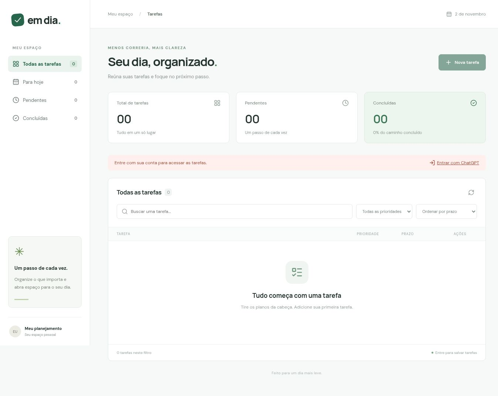

# Em dia - Gerenciador de tarefas

**Sistema:** https://tarefas-nicollas-2026.windylens.chatgpt.site

A página é pública; clique em **Entrar com ChatGPT** para usar suas tarefas. O GitHub ainda está pendente; este endereço é o sistema publicado.

Projeto acadêmico desenvolvido com apoio do ChatGPT/Codex. Organiza tarefas da faculdade e do cotidiano, com CRUD completo, prioridade, prazo, pesquisa e status.

## Funcionalidades
- Cadastro de título, descrição, prioridade, prazo e status.
- Listagem, busca textual, consulta, filtros e ordenação.
- Edição, conclusão, reabertura e exclusão com confirmação.
- Resumo de pendentes, concluídas e prazos vencidos.
- Dados persistentes, com acesso limitado ao proprietário autenticado.
- Validação no servidor, mensagens de erro e layout adaptável.
- Proteção contra sobrescrita de edição antiga e cadastro repetido.

## Tecnologias
React, TypeScript, CSS, Vinext/Vite e rotas HTTP; Cloudflare Workers e D1 (SQLite). Drizzle para schema e migrations. Testes com `node:test`, HTTP real e SQLite nativo. O starter de hospedagem inclui componentes/dependências opcionais que não são usados na tela principal.

## Instalação e execução local
Requisitos: **Node.js 24**, npm e Git. Não exige chave secreta do aluno.

1. Clone ou extraia este projeto e abra um terminal na pasta.
2. Instale: `npm install` (ou `corepack pnpm install --frozen-lockfile`).
3. Execute os testes: `npm test`.
4. Gere o build: `npm run build`.
5. Na primeira execução, aplique a migration **somente no banco local**:

```sh
node --import ./scripts/sites-env.mjs ./node_modules/wrangler/bin/wrangler.js d1 execute DB --local --config dist/server/wrangler.json --persist-to .wrangler/state --file drizzle/0000_violet_rick_jones.sql
```

6. Rode `npm run dev` e abra o endereço exibido no terminal. Em ambiente portátil, o starter disponibiliza um login local simulado: clique em **Entrar com ChatGPT**. Esse login de desenvolvimento é restrito a localhost e não é usado no deploy. Na prévia gerenciada do ChatGPT ele não fica disponível; use o sistema publicado para autenticação real.

Não execute a migration inicial duas vezes no mesmo banco. Não use `--remote` em testes. `npm start` serve o build local, mas não simula login; para desenvolvimento prefira `npm run dev`.

## Persistência e segurança
D1 mantém os registros no servidor, entre sessões e dispositivos. Cada tarefa tem owner fornecido pela identidade verificada da plataforma. O front-end nunca decide a permissão. SELECT, UPDATE e DELETE filtram owner; todas as consultas usam parâmetros. O banco não é exposto por API SQL. RLS/Supabase não se aplicam.

Em outro provedor, não basta confiar em cabeçalhos enviados pelo navegador: é necessário implementar autenticação confiável ou manter o proxy Sites. Não existe login por senha próprio. Nenhuma credencial é necessária no README, no código ou em `.env.example`; o vínculo D1 é configurado pela hospedagem. Dados de desenvolvimento e teste são separados dos dados hospedados.

## Arquivos principais
| Arquivo | Responsabilidade |
|---|---|
| app/page.tsx | Tela, formulário, filtros e chamadas à API |
| app/globals.css | Aparência e adaptação para telas menores |
| app/api/tasks/[[...path]]/route.ts | Liga autenticação e banco ao handler |
| lib/tasks.mjs | Protocolo HTTP e coordenação do CRUD |
| lib/task-validation.mjs | Regras de preenchimento |
| lib/task-repository.mjs | SQL parametrizado e titularidade |
| db/schema.ts / drizzle | Estrutura do banco e migration |
| tests/tasks.test.mjs | Cenários de integração |

API: GET/POST `/api/tasks`; GET/PUT/DELETE `/api/tasks/:id`. Escritas exigem JSON e origem correspondente. PUT/DELETE exigem a versão atual. Cadastro usa UUID v4 estável durante repetição. ID repetido com dados diferentes retorna 409; edição obsoleta também retorna 409.

## Auditorias e testes
Ordem aplicada: **Prompt 4 → Prompt 1 → Prompt 3 → Prompt 2**.

- [AUDITORIA.md](AUDITORIA.md): diagnóstico inicial preservado.
- [Planejamento](docs/PLANEJAMENTO.md).
- [Segurança](docs/PROMPT_1_SEGURANCA.md).
- [Testes e limites de cobertura](docs/PROMPT_3_TESTES.md).
- [Refatoração segura](docs/PROMPT_2_REFATORACAO.md).
- [Resumo dos quatro prompts](docs/RESULTADOS.md).
- [Saída dos testes após a refatoração](docs/evidencias/testes-refatoracao-2.txt).

**25 testes passaram; 0 falharam; 0 ignorados.** `npm test` cria SQLite real em pasta temporária, sobe HTTP local, exercita o handler publicado e apaga somente o banco temporário. A identidade externa é simulada; a suíte não valida o provedor ChatGPT, o wrapper Vinext nem o serviço D1 remoto. Não há mock do banco ou da regra de negócio.

Veja também a [verificação visual e suas pendências](docs/VALIDACAO_MANUAL.md).



## Limitações conhecidas
Sem paginação, recuperação de exclusão ou compartilhamento de tarefas. Sem operação offline. Fonte remota tem fallback local. Não usar como armazenamento único de informação importante. Fluxos de pagamento, estoque, plano e webhook são não aplicáveis.

## Entrega acadêmica
Confira `docs/ENTREGA_CLASSROOM.md`. Complete turma e relato pessoal após revisar e demonstrar o sistema. Publicação no GitHub e acesso externo devem ser confirmados antes de enviar ao Classroom. O repositório interno do Sites não substitui o GitHub exigido pela atividade.
